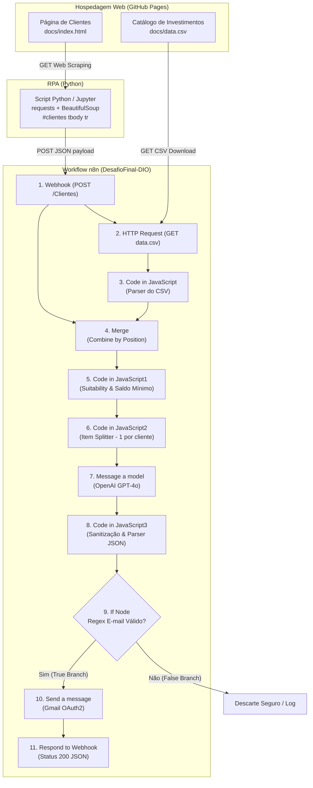
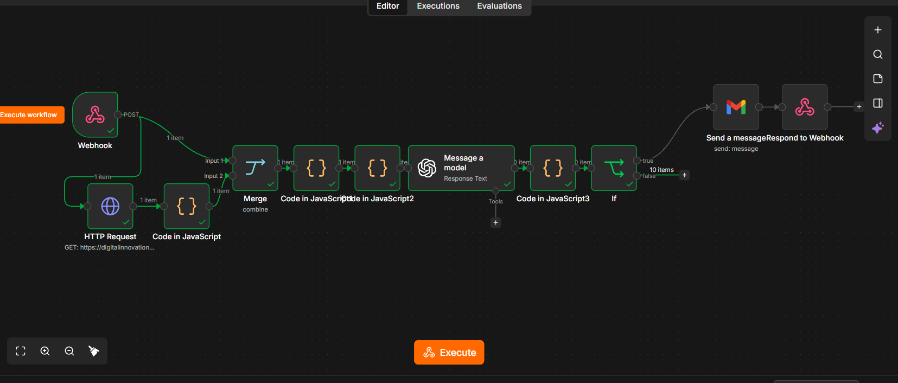
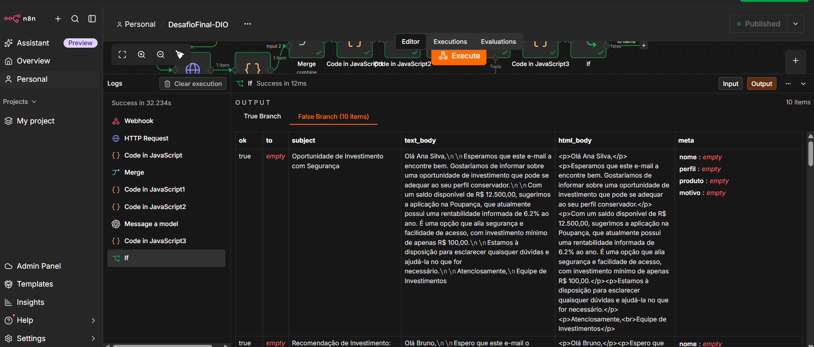

# Assistente de Investimentos com RPA e IA Generativa

> **Projeto Final / Desafio de Projeto DIO**  
> Repositório Base: [digitalinnovationone/dio-lab-assistente-investimentos-rpa-n8n](https://github.com/digitalinnovationone/dio-lab-assistente-investimentos-rpa-n8n)  
> Fork e Implementação: **Elizeu Couto**

---

## 1. Descrição do Projeto

Este projeto consiste em um pipeline completo de automação inteligente voltado ao setor financeiro. A solução integra **Robotic Process Automation (RPA)** em Python para raspagem de dados web, orquestração de microsserviços via **n8n**, inteligência artificial generativa com **OpenAI GPT-4o** para redação personalizada de recomendações de investimento e disparo automatizado de e-mails via **Gmail**.

O fluxo coleta registros de investidores em uma interface web simulada, consulta um catálogo dinâmico de produtos financeiros, cruza regras de adequação de perfil (*suitability*) e saldo mínimo, submete o contexto a um modelo de linguagem para criar uma comunicação individualizada e amigável (sem promessas de ganhos financeiros) e encaminha a mensagem por e-mail após validação sintática estrita.

---

## 2. Objetivo

- **Automatizar a captura de dados de clientes** a partir de interfaces sem API pública disponível, utilizando técnicas de web scraping com BeautifulSoup.
- **Orquestrar o fluxo de dados no n8n**, combinando dados de entrada transacionais com catálogos externos em CSV.
- **Aplicar regras de negócio financeiras**, selecionando ativos adequados ao perfil de risco (Conservador, Moderado ou Arrojado) e ao capital disponível.
- **Gerar recomendações hiperpersonalizadas via LLM**, produzindo saídas estruturadas em JSON com versões em texto simples e HTML.
- **Validar defensivamente os contatos (Regex)** e notificar os clientes finais por e-mail de forma automatizada e segura.

---

## 3. Arquitetura do Fluxo

O diagrama abaixo detalha a topologia da solução, desde a raspagem inicial na página web até a entrega do e-mail ao cliente e a resposta síncrona ao disparador:



---

## 4. Tecnologias Utilizadas

| Etapa | Ferramenta / Biblioteca | Função Técnica |
|---|---|---|
| **Hospedagem de Dados** | GitHub Pages | Distribuição estática da página de clientes (`index.html`) e da tabela de ativos (`data.csv`). |
| **Extração (RPA)** | Python 3, `requests`, `BeautifulSoup4` | Raspagem tabular (`#clientes tbody tr`), estruturação em dicionários e envio via POST. |
| **Orquestração** | n8n (Workflow Automation) | Recepção de webhooks, junção de fluxos, execução de scripts JavaScript e roteamento condicional. |
| **Manipulação de Dados** | JavaScript (Node.js runtime n8n) | Parsing de CSV, conversão e formatação monetária (BRL), lógica de suitability e desmembramento de lotes. |
| **Inteligência Artificial** | OpenAI (`gpt-4o` via LangChain) | Geração de texto personalizado e persuasivo, restrito a saídas JSON estruturadas. |
| **Validação** | Regex (`n8n-nodes-base.if`) | Filtro de conformidade sintática de e-mails (`^[^@\s]+@[^@\s]+\.[^@\s]+$`). |
| **Mensageria / Saída** | Google Gmail OAuth2 | Disparo automatizado dos e-mails com corpo em HTML gerado pelo modelo. |

---

## 5. Estrutura do Repositório

```text
dio-lab-assistente-investimentos-rpa-n8n/
├── docs/
│   ├── data.csv                # Catálogo de ativos de investimento por perfil e valor mínimo
│   ├── index.html              # Interface web estática com tabela de clientes fictícios
│   ├── workflow-n8n.png        # Evidência: Visão geral da topologia no n8n
│   └── execucao-workflow.png   # Evidência: Execução bem-sucedida e mensagens geradas
├── n8n/
│   └── workflow.json           # Definição completa do fluxo exportada do n8n
├── rpa/
│   ├── extrair_clientes.ipynb  # Notebook Jupyter para experimentação e execução interativa
│   └── extrair_clientes.py     # Script Python executável em linha de comando / agendador
└── README.md                   # Documentação técnica integral do projeto
```

---

## 6. Descrição Detalhada dos Nós do Workflow

Abaixo está a análise técnica de cada um dos 11 nós presentes em `n8n/workflow.json`, na ordem real de execução:

### 1. Webhook (`n8n-nodes-base.webhook` v2.2)
- **ID**: `6b56e17a-0de0-4da7-a72e-3f3eabc68b1a`
- **Configuração**: Método `POST`, path `Clientes`, modo de resposta configurado como `responseNode`.
- **Entrada**: Payload HTTP POST disparado pelo RPA: `{"clientes": [{"nome": "...", "email": "...", "saldo": "...", "perfil": "..."}, ...]}`.
- **Saída**: Dados recebidos na requisição disponibilizados para as conexões subsequentes.
- **Lógica**: Serve como porta de entrada síncrona/reativa. Dispara em paralelo a entrada 0 do nó `Merge` e a requisição do catálogo no nó `HTTP Request`.

### 2. HTTP Request (`n8n-nodes-base.httpRequest` v4.5)
- **ID**: `23b47ac8-143d-49b5-b6fd-9bcf12aef667`
- **Configuração**: Método `GET`, URL: `https://digitalinnovationone.github.io/dio-lab-assistente-investimentos-rpa-n8n/data.csv`.
- **Entrada**: Trigger emitido pelo Webhook.
- **Saída**: Texto puro contendo as linhas e colunas do arquivo CSV de investimentos.
- **Lógica**: Recupera a fonte atualizada de opções de investimento em tempo de execução.

### 3. Code in JavaScript (`n8n-nodes-base.code` v2)
- **ID**: `9db0b64c-b519-419e-bdb9-52d0e4d34a0f`
- **Entrada**: String do CSV bruto vinda do nó HTTP Request.
- **Lógica**: Lê o texto bruto (`$json.data ?? $json.body ?? $json`), divide por quebras de linha (`\r?\n`), extrai o cabeçalho (`perfil,produto,minimo,rentabilidade`) e mapeia cada registro em um objeto JavaScript. Sanitiza o campo `minimo`, convertendo-o para número através de `replace(/[^\d]/g, "")`.
- **Saída**: Objeto único contendo a lista: `[{ json: { investimentos: [...] } }]`.

### 4. Merge (`n8n-nodes-base.merge` v3.2)
- **ID**: `bb421f61-232c-4645-9585-e790bc1825c1`
- **Configuração**: Modo `combine` com critério `combineByPosition`.
- **Entrada**:
  - `Input 1` (índice 0): Dados do Webhook (lista de clientes).
  - `Input 2` (índice 1): Dados do parser (lista de investimentos).
- **Saída**: Um único item agregado consolidando as propriedades `clientes` e `investimentos`.

### 5. Code in JavaScript1 (`n8n-nodes-base.code` v2)
- **ID**: `bbcb6c11-cdaf-4274-909a-4cc803d52410`
- **Função**: Mecanismo de Correspondência de Regras de Negócio (*Suitability*).
- **Entrada**: Item combinado contendo arrays de clientes e investimentos.
- **Lógica**:
  1. Converte valores monetários textuais em BRL (ex.: `"R$ 12.500,00"`) para números float (`12500`).
  2. Normaliza strings de perfil (caixa baixa e remoção de espaços em branco).
  3. Para cada cliente, filtra investimentos elegíveis onde:  
     $$\text{perfilInvestimento} = \text{perfilCliente} \quad \text{e} \quad \text{saldoCliente} \ge \text{investimentoMínimo}$$
  4. Seleciona o primeiro produto compatível (`compativeis[0]`).
  5. Monta mensagens de contingência (templates estáticos para fallback de MVP) e sinaliza o motivo (`saldo_ok` ou `sem_opcao_compativel`).
- **Saída**: Sumário consolidado com contadores e array de resultados:  
  `{ ok: true, total_clientes, total_investimentos, resultados: [...] }`.

### 6. Code in JavaScript2 (`n8n-nodes-base.code` v2)
- **ID**: `a71eba9e-6711-4da2-8231-24541d6681e4`
- **Função**: Desmembrador de Lote (*Item Splitter*).
- **Entrada**: Objeto único com o array `resultados`.
- **Lógica**: Itera sobre cada cliente analisado e devolve uma coleção de itens individuais no n8n. Cada item expõe: `email_to`, `nome`, `perfil`, `saldo_texto`, `saldo_num`, `recomendacao`, `motivo`, `mensagens` e `mensagem_escolhida`.
- **Saída**: Múltiplos itens individuais (1 item por cliente), permitindo que a IA processe cliente por cliente.

### 7. Message a model (`@n8n/n8n-nodes-langchain.openAi` v2.3)
- **ID**: `f2437edc-f33a-449a-a207-9cf5addd3112`
- **Modelo**: `gpt-4o` (OpenAI via conector LangChain).
- **Prompt**:
  > *"Escreva um e-mail curto em português do Brasil para o cliente abaixo. Seja cordial e claro. Não prometa ganhos nem dê garantias de rentabilidade.*  
  > *Cliente: ${$json.nome} | E-mail: ${$json.email_to} | Perfil: ${$json.perfil} | Saldo: ${$json.saldo_texto} | Produto: ${$json.recomendacao?.produto} | Mínimo: ${$json.recomendacao?.minimo} | Rentabilidade: ${$json.recomendacao?.rentabilidade} | Motivo: ${$json.motivo}*  
  > *Retorne somente um JSON válido, sem Markdown, neste formato: {"subject": "...", "text_body": "...", "html_body": "..."}"*
- **Saída**: Estrutura do LangChain contendo o texto gerado em `output[0].content[0].text`.

### 8. Code in JavaScript3 (`n8n-nodes-base.code` v2)
- **ID**: `82d01f48-8129-49a1-88e6-bab9b5a5c040`
- **Função**: Parser e Sanitizador de Saída da IA.
- **Entrada**: Resposta textual do modelo.
- **Lógica**:
  1. `extrairTexto`: Recupera o texto gerado navegando defensivamente pelas propriedades da resposta (`output[0].content...text`, `json.text` ou `json.message`).
  2. `converterParaObjeto`: Remove blocos delimitadores de código markdown (```` ```json ```` e ```` ``` ````), executa `JSON.parse` e possui fallback com regex de busca por chaves `{ ... }` caso a IA inclua texto adjacente.
  3. Mapeia a estrutura limpa com os campos: `to`, `subject`, `text_body`, `html_body` e objeto `meta`.
- **Saída**: Itens normalizados contendo o e-mail pronto para envio.

### 9. If (`n8n-nodes-base.if` v2.3)
- **ID**: `a5f632b8-d9f1-4bc8-bfd5-2cbf161be76e`
- **Regra**: Expressão regular estrita aplicada sobre o campo `to`:  
  `^[^@\s]+@[^@\s]+\.[^@\s]+$`
- **Lógica**:
  - **True Branch**: Destinatários com e-mail sintaticamente válido seguem para o envio.
  - **False Branch**: Contatos com e-mail vazio ou malformatado são retidos, evitando falhas de entrega e desperdício de cota no provedor de e-mail.

### 10. Send a message (`n8n-nodes-base.gmail` v2.2)
- **ID**: `57301e91-1478-4a44-a8ce-4eda107b1d63`
- **Credencial**: `gmailOAuth2` (OAuth 2.0).
- **Parâmetros**: `sendTo` = `={{ $json.to }}`, `subject` = `={{ $json.subject }}`, `message` = `={{ $json.html_body }}`.
- **Lógica**: Disparo oficial do e-mail em HTML personalizado via API do Google.

### 11. Respond to Webhook (`n8n-nodes-base.respondToWebhook` v1.5)
- **ID**: `8d9da4e3-3343-4b89-8867-4caaf7a18c98`
- **Configuração**: `respondWith`: "json", `responseBody`: `={{$json}}`, `responseCode`: 200.
- **Lógica**: Retorna confirmação HTTP 200 ao disparador original com os dados do processamento.

---

## 7. Decisões Técnicas

| Decisão Técnica | Justificativa de Engenharia e Negócio |
|---|---|
| **Uso de RPA (Web Scraping) em vez de API** | Simula a realidade corporativa em que portais internos, sistemas legados ou dados de terceiros não possuem APIs abertas. O robô emula a extração humana diretamente da tabela DOM `#clientes`. |
| **Uso de Webhook como porta de entrada** | Cria um desacoplamento limpo entre o coletor de dados (Python) e o motor de automação (n8n), permitindo execução assíncrona, agendamento por cronjobs e integração futura com múltiplos canais. |
| **Cruzamento por perfil e valor mínimo** | Garante conformidade com o princípio de *suitability* e viabilidade financeira: o cliente nunca recebe uma sugestão incompatível com sua tolerância a risco nem com exigência de aporte superior ao seu saldo disponível. |
| **Prompt ético e restritivo na IA** | Instruções explícitas (*"Não prometa ganhos nem dê garantias de rentabilidade"*) previnem violações regulatórias graves (ex.: normas de conduta da CVM / ANBIMA) e evitam alucinações sobre retornos futuros garantidos. |
| **Saída em JSON estruturado tratada em nó Code** | Elimina a instabilidade de respostas em linguagem natural. A exigência de chaves fixas aliada à sanitização contra delimitadores de Markdown (` ```json `) garante previsibilidade no fluxo de e-mail. |
| **Validação de e-mail por Regex no nó If** | Prática defensiva essencial em automação de mensageria: impede disparos para destinatários nulos ou corrompidos, protegendo a reputação do domínio contra *bounces* e evitando falhas na API do Gmail. |
| **Uso exclusivo de dados fictícios** | Total alinhamento com a **LGPD (Lei Geral de Proteção de Dados)**. Nenhuma informação pessoal sensível ou dados reais de contas são trafegados no ambiente educacional. |

---

## 8. Como Executar o Projeto do Zero

### Pré-requisitos
- Conta no [n8n Cloud](https://n8n.io/) ou instância n8n local (Docker/npm).
- Chave de API da [OpenAI](https://platform.openai.com/).
- Conta Google para autenticação OAuth2 no nó do Gmail (ou execução em modo de teste).
- Python 3.10+ instalado com as bibliotecas `requests` e `beautifulsoup4`.

```bash
pip install requests beautifulsoup4
```

### Passo a Passo

1. **Clonar o Repositório Forkado**:
   ```bash
   git clone https://github.com/Elizeu-Couto/dio-lab-assistente-investimentos-rpa-n8n.git
   cd dio-lab-assistente-investimentos-rpa-n8n
   ```

2. **Importar o Workflow no n8n**:
   - No n8n, clique em **Workflows** > **Add Workflow** > menu com três pontos (`...`) no canto superior direito > **Import from File**.
   - Selecione o arquivo `n8n/workflow.json`.

3. **Configurar as Credenciais no n8n**:
   - **Nó "Message a model"**: vincule sua credencial da OpenAI (`OpenAI account`) preenchendo sua API Key.
   - **Nó "Send a message"**: conecte sua credencial OAuth2 do Gmail (`Gmail account`).
   - *(Opcional para testes)*: Se não desejar disparar e-mails reais, você pode desativar o nó Gmail ou inspecionar a saída diretamente no nó `If`.

4. **Obter a Production URL do Webhook**:
   - Abra o nó **Webhook**.
   - Alterne para a aba **Production URL** e copie o endereço gerado (algo como `https://sua-instancia.app.n8n.cloud/webhook/Clientes`).

5. **Configurar o Script de RPA**:
   - Abra o arquivo `rpa/extrair_clientes.py` (ou `rpa/extrair_clientes.ipynb`).
   - Localize a linha da variável `N8N_WEBHOOK`:
     ```python
     N8N_WEBHOOK = "COLE_AQUI_A_PRODUCTION_URL_DO_N8N"
     ```
   - Substitua o placeholder pela sua URL de produção copiada do n8n.

6. **Ativar o Workflow**:
   - No n8n, alterne o botão no canto superior direito de **Inactive** para **Active / Published**.

7. **Executar a Coleta e Disparo**:
   - Execute o script Python via terminal:
     ```bash
     python rpa/extrair_clientes.py
     ```
   - Ou abra o notebook `rpa/extrair_clientes.ipynb` no Jupyter / Google Colab e execute as células sequencialmente.

8. **Acompanhar a Execução**:
   - Verifique a saída no console com os prints de status HTTP 200.
   - No n8n, acesse o menu lateral **Executions** para auditar os dados processados em cada nó.

---

## 9. Evidências do Funcionamento

### 9.1 Visão Geral do Workflow no n8n
Topologia completa do pipeline configurado no n8n, ilustrando as rotas paralelas de dados, cruzamento, processamento via modelo LangChain e bifurcação condicional:



*Legenda: Pipeline no n8n com Webhook de entrada, consulta HTTP do catálogo CSV, nós Code de processamento e suitability, nó OpenAI GPT-4o, nó de sanitização JSON, validação de e-mail e nó Gmail.*

---

### 9.2 Execução do Workflow e Mensagens Geradas pela IA
Registro de execução real em ambiente n8n, exibindo a tabela gerada pela IA com os 10 clientes processados:



*Legenda: Execução bem-sucedida (tempo de processamento: 32.234s). O print ilustra a tabela de saída do nó If contendo os 10 itens gerados com assunto (`subject`), corpo em texto (`text_body`) e código HTML (`html_body`).*

> **Nota Técnica da Execução [CONFIRMAR]**:  
> No registro capturado em tela, os 10 itens seguiram para o `False Branch` do nó `If` porque a propriedade `to` avaliou como vazia na extração do nó LangChain. Isso ocorreu porque o conector padrão do LangChain entrega apenas o objeto `output`, exigindo referenciar o e-mail via paired items (`$('Code in JavaScript2').item.json.email_to`) ou solicitar o campo `to` no próprio schema do prompt. O nó `If` cumpriu perfeitamente sua função de segurança, retendo o envio em lote e evitando falhas de execução no nó Gmail.

---

## 10. Limitações e Melhorias Futuras

- **Pass-through de Atributos no Nó LangChain**: Ajustar o mapeamento no nó `Code in JavaScript3` para utilizar `$('Code in JavaScript2').item.json.email_to`, garantindo que o endereço de e-mail seja propagado diretamente para o nó `If` e para o `Send a message` sem depender do retorno da LLM.
- **Fila Assíncrona de Mensageria (RabbitMQ / SQS)**: Em ambientes corporativos de larga escala com milhares de investidores, a utilização de filas evita *rate limits* na API da OpenAI e suporta retentativas automáticas (*dead-letter queues*).
- **Enriquecimento Dinâmico de Mercado**: Integrar nós de HTTP adicionais para consultar índices em tempo real (ex.: cotação atualizada da taxa Selic, CDI e IPCA) antes de gerar o texto da recomendação.
- **Fallback Automático para Templates Estáticos**: Configurar rota alternativa para que, caso a API da OpenAI retorne erro ou atinja limite de requisições, o fluxo utilize as mensagens pré-definidas no nó `Code in JavaScript1` sem interromper a comunicação.

---

## 11. Aviso Legal

> **AVISO IMPORTANTE**: Este projeto foi desenvolvido exclusivamente para fins educacionais e didáticos como parte dos programas de formação da **Digital Innovation One (DIO)**. Os dados de clientes e simulações financeiras apresentados são inteiramente fictícios. Nenhuma das mensagens ou dados gerados constitui recomendação de investimento, análise financeira, consultoria ou promessa de retorno por parte dos autores.

---

## 12. Checklist dos Entregáveis

### MVP (Mínimo Viável)
- [x] Repositório forkado e estruturado a partir da base da DIO.
- [x] Workflow n8n exportado e versionado (`n8n/workflow.json`).
- [x] Script de RPA Python integrado via Webhook (`rpa/extrair_clientes.py` e `rpa/extrair_clientes.ipynb`).
- [x] Tratamento de erros HTTP, timeouts e prints informativos no script de extração.
- [x] Placeholder padronizado de segurança para a URL do Webhook (`COLE_AQUI_A_PRODUCTION_URL_DO_N8N`).
- [x] Evidências visuais de funcionamento registradas no repositório (`docs/workflow-n8n.png`).

### Desafio Completo
- [x] Integração completa com Agente de Inteligência Artificial Generativa (OpenAI `gpt-4o`).
- [x] Mensagens geradas dinamicamente com personalização por cliente, saldo e ativo recomendado.
- [x] Prompt defensivo e ético em conformidade regulatória (sem promessas de ganhos).
- [x] Saída estruturada em JSON com versões em texto simples e HTML.
- [x] Tratamento e sanitização de blocos de Markdown via nó Code em JavaScript.
- [x] Validação sintática de destinatário de e-mail com Expressão Regular (Regex).
- [x] Rota de envio com conector oficial do Gmail via OAuth2.
- [x] Resposta síncrona HTTP 200 via nó Respond to Webhook.
- [x] Documentação técnica completa e aprofundada com diagrama arquitetural Mermaid.
